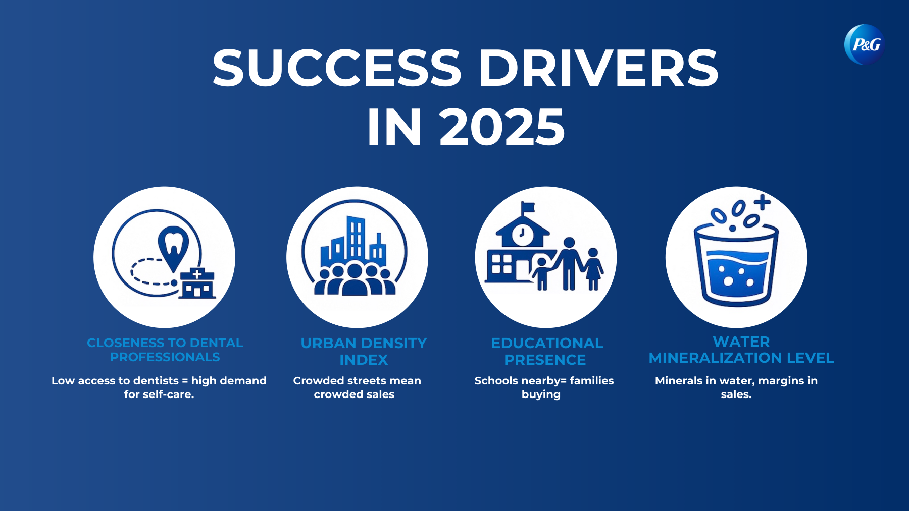
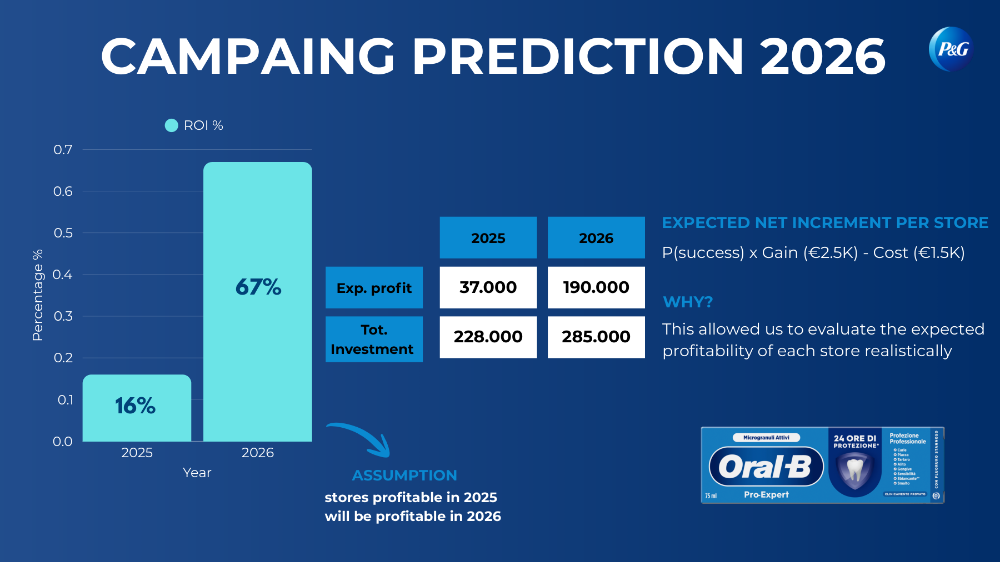
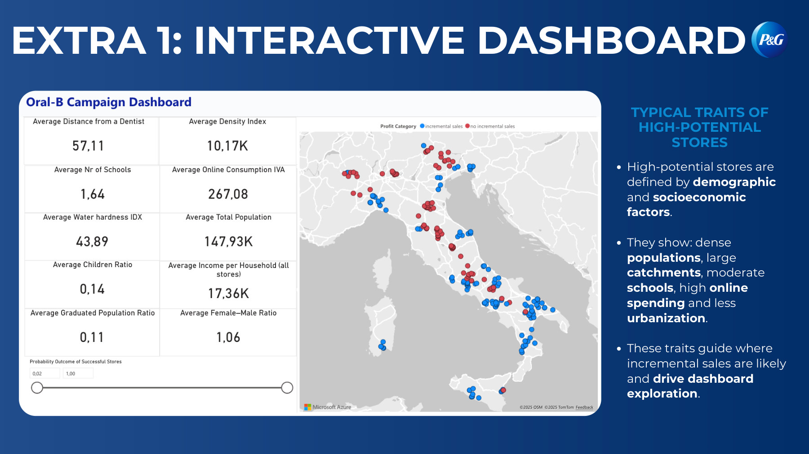

# Oral-B Campaign Analytics

**SmileMetrics: data-driven store targeting for a 2026 Oral-B toothpaste campaign**

Group academic project developed as part of the **Business and Marketing Analytics** course during my Bachelor's degree in Management and Computer Science at LUISS Guido Carli (A.Y. 2025/2026).

**Team (Group J):** Matteo Bruni, Giulia Castelli, Nikita Fyodorov, Anna Granzotto, Francesca Peppoloni, Matteo Rapisarda, Emanuel Rizzo, Andrea Scarso, Sara Vagheggini

**My contribution:** KNIME workflow and predictive model, additional data integration (Extra 2), communication proposal (Extra 3) and slides.

---

## Business Case

Acting as marketing analysts at P&G, we were asked to optimise the **2026 geolocated campaign for the new Oral-B toothpaste line-up** in Italy. In 2025 the campaign ran only in selected stores, and for each of them we knew whether it generated meaningful incremental sales.

Using the 2025 results and the features of all Italian points of sale (catchment population, demographics, income, schools, hygienists, distance from dentists, water hardness, online consumption), the goals were to:

1. explain **which store features drive campaign success**;
2. build a **predictive model** to choose in which stores to run the 2026 campaign and estimate the **"size of the prize"** compared with 2025;
3. recommend **communication activities** for the high-potential stores.

Business assumptions: each successful store generates **€2.5k** in incremental sales, and activating a store costs **€1.5k**.

---

## Approach

- **Data preparation in KNIME:** joins, duplicate removal, derived indicators (e.g. urban density index), normalisation and correlation-based feature filtering
- **Model comparison** with cross-validation: Logistic Regression, Decision Tree, Random Forest and XGBoost, evaluated with accuracy, confusion matrices and ROC curves
- **Selected model: Random Forest** (91% accuracy vs 89% for the Decision Tree), used to compute each store's probability of success
- **Store selection rule:** a store is activated when its expected net increment is positive,
  `P(success) × €2.5k − €1.5k > 0`
- **Geospatial enrichment:** stores mapped to Italian regions (NUTS2) with a spatial join, then enriched with **ISTAT disposable household income** by region
- **Interactive Power BI dashboard** to explore the typical traits of high-potential stores across Italy



---

## Key Results

| | 2025 campaign | 2026 recommendation |
|---|---|---|
| Stores activated | 152 | 190 (model-selected) |
| Total investment | €228k | €285k |
| Expected profit | €37k | **€190k** |
| ROI | 16% | **67%** |

- **Success drivers:** closeness to dental professionals (low access to dentists means more self-care demand), urban density, presence of schools (families) and water mineralisation level.
- **Additional data:** adding ISTAT regional income showed that higher purchasing power increases store potential; accuracy moved slightly from 91% to 90.8%, but the model became more robust and easier to interpret.
- **Communication proposal ("ToothTok"):** a 7-day whitening challenge on TikTok with micro-creators and TikTok Shop, since whitening is the most social-media-driven oral-care need.

### Success drivers


### 2026 campaign prediction


### Power BI dashboard


---

## Technologies

**KNIME Analytics Platform** (incl. Geospatial extension) · **Power BI** · **Random Forest** · **Logistic Regression** · **Decision Trees** · **XGBoost** · **Excel** · **Canva**

---

## Repository Structure

```text
oral-b-campaign-analytics/
├── README.md
├── OralB_KNIME_project.knwf          # KNIME workflow (import via File > Import KNIME Workflow)
├── datasets/
│   ├── ISTAT/                        # disposable household income by region (public)
│   └── Eurostat/NUTS2 shapefiles/    # NUTS2 regional boundaries (public)
├── assets/                           # figures used in this README
└── docs/
    └── presentation.pdf              # final presentation
```

---

## Data Availability

The store-level datasets (`Italian_Stores.xlsx`, `OralCare_activated_Stores_2025.xlsx`) were provided by the course as part of a **business case for internal use** and are **not included** in this repository. For the same reason, the model outputs and the Power BI file (`.pbix`, which embeds the data) are not published.

The input store data contained, for each point of sale: store code, latitude and longitude, water hardness index, online consumption index, number of schools and hygienists, distance from a dentist, population by sex, marital status and age group, graduated and unemployed population, number of students, households and average household size, average income per household; the 2025 file added the campaign outcome (success / no success).

The public data included here comes from **ISTAT** (disposable income of consumer households by region, 2023) and **Eurostat GISCO** (NUTS 2024 boundaries, © EuroGeographics for the administrative boundaries).

To open the workflow, import `OralB_KNIME_project.knwf` into KNIME and place the `datasets/` folder next to the workflow folder in your KNIME workspace. Without the confidential store data the workflow cannot be re-executed, but every node, setting and comment can be inspected.

---

## What I Learned

- Turning a **marketing question into a predictive-modelling problem** with a clear business objective (profit, not only accuracy)
- Building and comparing classification models in a **visual analytics tool (KNIME)** with cross-validation
- Using model probabilities to make a **cost-benefit decision** and estimate the "size of the prize"
- Enriching internal data with **open external sources** (ISTAT, Eurostat) through a spatial join
- Presenting technical results as a **data story** for non-technical marketing managers, as part of a team of nine
